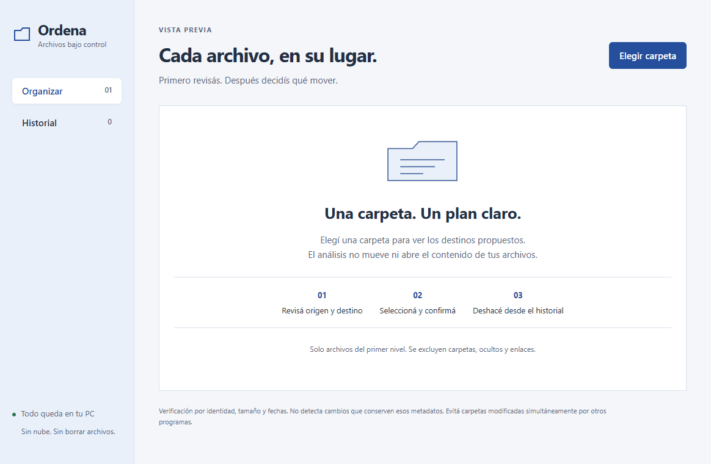

# Ordena · Archivos bajo control

## Problema y solución

Mover archivos sin revisar los destinos puede producir conflictos y perder el rastro de los cambios. Ordena analiza una carpeta local, muestra una propuesta y mueve solamente los archivos seleccionados tras la confirmación. Conserva historial y permite deshacer comprobando cambios.

## Tecnologías y decisión relevante

Electron, React, TypeScript y SQLite. El registro guarda la intención antes del movimiento y el resultado después: filesystem y base de datos no forman una transacción única. Al reiniciar, la aplicación reconcilia operaciones interrumpidas sin repetir movimientos automáticamente.

## Desarrollo con IA

Proyecto desarrollado con asistencia de IA en especificación, implementación y revisión. La documentación registra correcciones sobre recuperación de operaciones y restricciones de carpetas sincronizadas.

## Evidencia y alcance

La validación local del 5 de octubre de 2026 documenta instalación limpia, tipos, compilación, 19 pruebas del motor y 2 E2E Electron aprobados: 21 en total. Esta presentación no vuelve a ejecutar esa suite.

MVP local para Windows x64; máximo 1000 elementos del primer nivel. No lee contenido, no borra archivos y omite conflictos. Excluye enlaces y rutas sincronizadas no admitidas. No garantiza detectar cambios que conserven todos los metadatos. Código privado y paquete sin firma; no se distribuyen ejecutables en este caso.

## Recorrido para una demostración

1. Elegir una carpeta ficticia.
2. Revisar destinos y un conflicto de nombre.
3. Seleccionar y confirmar un movimiento.
4. Ver el historial y deshacer.
